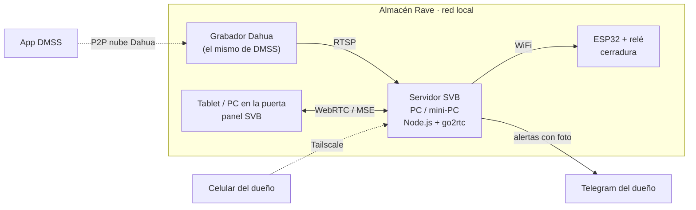
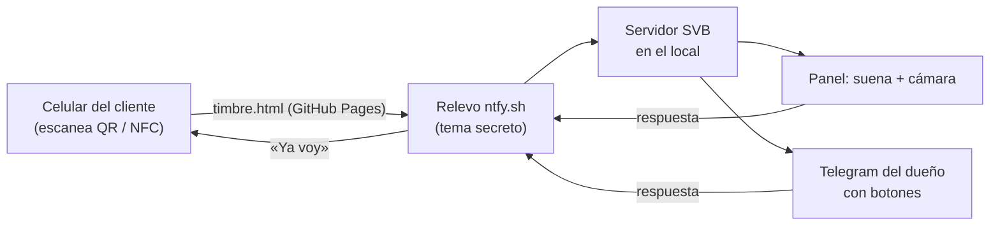

# SVB Seguridad · Almacén Rave

**Sistema Vincular Business — Soluciones de Seguridad.** Panel de seguridad táctil (web, celular y Windows) con cámaras Dahua en vivo, control de cerradura, PIN de coacción, botón SOS 911, asistente de voz, pases QR/NFC para proveedores, detección de merodeo y sabotaje con IA en el borde, y alertas con foto al celular del dueño.

  

---

## Cómo funciona



- **DMSS sigue funcionando igual.** DMSS entra por P2P (la nube de Dahua) con el número de serie. Los navegadores no pueden usar ese P2P, así que el **servidor SVB** se conecta al grabador **por la red local** (RTSP) y convierte el video a WebRTC/MSE con [go2rtc](https://github.com/AlexxIT/go2rtc).
- **No hace falta saber la IP del grabador:** con `CAM_HOST=auto`, el servidor barre la red y encuentra el equipo cuyo número de serie coincide con el de DMSS.
- **El panel funciona aunque se caiga el servidor** (modo autónomo con PINs de respaldo y cámara local).

## Instalación rápida (Windows)

1. Instalar **Node.js LTS** desde <https://nodejs.org>.
2. Descargar este repositorio (botón verde **Code → Download ZIP**) y descomprimirlo, por ejemplo en `C:\SVB`.
3. Doble clic en **`iniciar-windows.bat`**. La primera vez crea el archivo `.env` y lo abre en el Bloc de notas.
4. Completar en `.env` con los datos de DMSS (DMSS → Dispositivos → *rave* → ⓘ):
   ```ini
   CAM_SERIAL=<Número de serie que muestra DMSS>
   CAM_USER=admin
   CAM_PASS=<Contraseña del dispositivo>
   CAM_HOST=auto
   ```
   y cambiar `DOOR_PIN`, `DURESS_PIN` y `ADMIN_PIN`. Guardar.
5. Doble clic otra vez en `iniciar-windows.bat`. Descarga go2rtc, busca el grabador y abre <http://localhost:8080>.
6. En la tablet de la puerta (misma WiFi) abrir `http://IP-DE-LA-PC:8080` y en el menú del navegador elegir **Instalar app / Agregar a pantalla de inicio**.

> La PC del servidor tiene que estar en **la misma red** (WiFi o cable) que el grabador Dahua. Si Windows pregunta por el firewall, permitir **redes privadas**.

### Si no encuentra el grabador
- Ejecutar `cd server && npm run discover` para ver qué equipos hay en la red.
- O buscar la IP del grabador en el router (lista de dispositivos DHCP) o con la app *ConfigTool* de Dahua, y ponerla fija: `CAM_HOST=192.168.1.108`.
- Verificar en el grabador que **RTSP esté habilitado** (Configuración → Red → Puerto → RTSP 554) — viene activado de fábrica.

## Funciones

| Módulo | Qué hace |
|---|---|
| **Teclado + PIN** | Abre la cerradura. 5 errores → bloqueo de 60 s y aviso al dueño. Validación del lado servidor. |
| **Personas y accesos** | Cada dueño, empleado o proveedor entra con **su propio PIN** (guardado cifrado) y queda registrado quién abrió y a qué hora. Se pueden habilitar y deshabilitar. El PIN general sigue funcionando. |
| **Horario de atención** | Franjas por día (varias, también cruzando la medianoche), siempre abierto o cerrado manual. Fuera de horario se bloquean timbre, pases, NFC y proveedores; el cliente que toca el timbre ve el horario en su celular. El dueño y el PIN general entran siempre; los empleados, si se permite. Opcional: **armar el sistema al cerrar y desarmarlo al abrir**. |
| **Huella del personal** | Passkeys (WebAuthn): huella del celular de la persona o del sensor del equipo. El servidor verifica la firma; la huella nunca sale del celular. Requiere consentimiento registrado. |
| **Rostro del personal** | Reconocimiento facial con la cámara de puerta (canal Dahua o tablet), con parpadeo obligatorio. Solo se guarda una plantilla numérica en el servidor, sin fotos. |
| **PIN de coacción** (`9999`) | Abre normalmente, **sin ninguna diferencia visible**, pero toma 3 fotos encubiertas, registra `CRITICAL_DURESS_EVENT` y manda alerta silenciosa con foto a Telegram. |
| **SOS 911** | Cuenta regresiva de 3 s (cancelable), foto automática, alerta al dueño y llamada `tel:911`. |
| **Familiar** | Llamada al contacto de confianza + WhatsApp de auxilio con ubicación. |
| **Timbre** | 5 timbres sintetizados; manda la foto del visitante al celular del dueño. |
| **Monitor de cámaras (estilo DMSS)** | Pantalla completa sin teclado, divisiones **1 / 4 / 9 / 16**, páginas, **arrastrar para ordenar** (se recuerda), doble clic para ampliar en HD, ajustar/llenar imagen, modo IR/noche, reconexión automática. |
| **Herramientas por cámara** | Foto, **grabar clip**, escuchar audio, **hablar** (cámaras con parlante), **ventana flotante**, **PTZ** (cámaras motorizadas), ampliar. |
| **Eventos del grabador (push)** | Movimiento, persona/vehículo, intrusión, cruce de línea, cámara tapada, pérdida de video, alarmas y disco, en vivo en el panel (la cámara se resalta) + avisos del navegador. |
| **Armar / Desarmar** | Con el sistema **armado** (local cerrado), cada movimiento manda **foto a Telegram**. Desarmado: solo sabotaje, pérdida de video, alarmas y disco. |
| **Grabaciones** | Reproducción del disco del grabador por cámara, fecha y hora. |
| **Portero digital QR / NFC** | Cartel con QR (y sticker NFC) en la puerta: el cliente lo escanea con **su celular**, elige motivo (cliente, delivery, proveedor), toca el timbre y **ve tu respuesta en su pantalla**. Suena en el panel con la cámara de la puerta y te llega a Telegram con botones: *Ya voy · Un momento · Dejar en la puerta · No atendemos · Abrir puerta*. |
| **Centro de configuración** | **Todo** se configura desde el panel, sin tocar archivos: negocio, PINs, usuario/contraseña del panel, grabador (IP auto, serie, usuario, clave, cámaras, nombres, eventos), cerradura (buscar y **vincular sola**), avisos (WhatsApp, push, Telegram) y portero. Se aplica al instante. Los ajustes del panel (contactos, voz, timbres, logo, orden de cámaras) se **comparten entre todos los equipos**. |
| **Avisos a los dueños** | **WhatsApp** a los números que elijan (CallMeBot, gratis), **notificación push** al celular con foto y botones (app ntfy, gratis) y **Telegram**. Se elige qué avisos van por cada canal (todo / importantes / solo timbre). Si se corta internet, timbre, SOS, coacción y alarmas **se reintentan durante 15 minutos**. Botón *Enviar aviso de prueba a todos*. |
| **Edge AI** | Movimiento, **merodeo** (presencia > 10 s sin interactuar), **sabotaje** (lente tapado/cegado), detección de rostro (nativa si el navegador la tiene, simulada si no). Cualquier cámara Dahua puede ser la "cámara de puerta". |
| **Voz** | «abrir puerta 2 5 8 0», «emergencia», «llamar a 911», «ver cámaras», «tocar timbre», «cancelar». Sin servicios pagos. |
| **Pases QR / NFC** | Códigos de 6 dígitos con vencimiento y **cantidad de usos** para proveedores; QR por cámara o **lector QR USB/Bluetooth**, tag NFC (Android) o tipeados. Envío por WhatsApp. Solo en horario de atención. |
| **Auditoría** | Log en el servidor (`data/events.jsonl`) + en el panel; exportación JSON y **CSV para Excel**; bóveda de fotos de evidencia. |
| **Admin** (PIN `1234`, **doble toque** en una zona libre o ⚙) | Lista de **puesta en marcha**, horario, personas, huella y rostro, soporte del desarrollador, configuración rápida, info del grabador (modelo, firmware, disco), marca/logo, perfil Residencial/Corporativo, contactos, voz, pases, timbres, relé 100–10000 ms, cámaras, firmware ESP32, manual de streaming, auditoría, sistema. |

## Cerradura (ESP32) — sin editar código

Firmware: [`firmware/esp32_cerradura/esp32_cerradura.ino`](firmware/esp32_cerradura/esp32_cerradura.ino) (también en Admin → Firmware).

1. Grabarlo tal cual (Arduino IDE 2 + *esp32 by Espressif*, placa *ESP32 Dev Module*).
2. Al encenderlo crea la red WiFi **SVB-Puerta-XXXX** (clave `svbpuerta`). Conectarse con el celular, elegir el WiFi del local y su clave → **Guardar**.
3. Panel → ⚙ → **Configuración → Cerradura → Buscar y vincular cerradura**: la encuentra y la vincula con una clave segura.

Para reconfigurar: mantener el botón **BOOT** 5 segundos.

| ESP32 | Conexión |
|---|---|
| GPIO 26 | IN del módulo relé (5 V) |
| GPIO 27 | Sensor magnético de puerta → GND (opcional) |
| GPIO 25 | Pulsador de salida interior → GND (opcional) |
| Relé NA/COM | Cerradura eléctrica 12 V (fuente propia; diodo 1N4007 en paralelo) |

Sin ESP32, la apertura queda **simulada** (se registra pero no acciona nada).

## Personas, horario, huella y rostro

Traído del Portero Cannabismática y adaptado al servidor (todo se guarda en `data/access.json`, fuera del repositorio).

1. **Personas y accesos:** agregar dueños, empleados y proveedores, cada uno con su PIN de 4 a 8 números. No se puede repetir un PIN ni usar el general, el de coacción o el de administración.
2. **Horario de atención:** elegir *Según el horario semanal* y cargar las franjas (ej. 9 a 13 y 17 a 21). *Cerrado* sirve para feriados o vacaciones.
3. **Huella y rostro** (opcional, apagado de fábrica): marcar el consentimiento de la persona y registrar su huella o su rostro; después activar *Permitir ingreso con huella / rostro*. En la pantalla principal aparecen los botones **Huella** y **Rostro**.

| Quién | En horario | Fuera de horario |
|---|---|---|
| PIN general / coacción | entra | entra |
| Dueño | entra | entra |
| Empleado | entra | entra si está permitido |
| Proveedor / pase de visita | entra | no (queda registrado y avisa) |
| Cliente con el timbre | suena | ve el horario en su celular |
| SOS 911 | siempre | siempre |

**Huella:** los navegadores solo permiten passkeys en direcciones seguras. Funciona en la PC del servidor (`http://localhost:8080` con Chrome o Edge) o por https: `tailscale serve --bg 8080` y abrir `https://<pc>.<tu-red>.ts.net` en la tablet. Las huellas quedan atadas a esa dirección.
**Rostro:** usa los modelos de `face/` ([face-api](https://github.com/vladmandic/face-api), MIT, unos 8 MB que se cargan solo al usarlo). Con un canal Dahua como cámara de puerta funciona desde cualquier dirección; con la cámara de la tablet hace falta https o localhost. Es menos seguro que la huella: un video de la persona podría engañarlo.
Son **datos personales sensibles**: registrar solo con consentimiento informado y por escrito. Al retirarlo, eliminar a la persona o pasarla a proveedor se borran su huella y su rostro.

## Avisos al celular de los dueños

Panel → ⚙ → **Configuración → Avisos a los dueños**:

- **WhatsApp (CallMeBot, gratis, uso personal):** cada dueño agenda el número de CallMeBot que figura en callmebot.com, le escribe `I allow callmebot to send me messages` y recibe su clave. Se cargan número + clave (varios dueños). Sin foto.
- **Notificación push (app ntfy, gratis):** instalar *ntfy* y suscribirse al tema que muestra el panel (o escanear el QR en Android). Llega con foto y, en el timbre, botones *Ya voy · Un momento · Dejar en puerta*.
- **Telegram:** @BotFather → `/newbot` → pegar el token → **Conectar Telegram**.
- **Enviar aviso de prueba a todos** muestra el resultado por canal y por número.

## Portero digital (timbre con QR / NFC)



1. **Activar la página pública (una vez):** GitHub → repositorio → **Settings → Pages** → Branch **main** / **(root)** → **Save**.
2. Panel → ⚙ → **Portero QR / NFC** → **Imprimir cartel para la puerta**.
3. (Opcional) Desde un Android con Chrome: **Grabar sticker NFC** (NTAG213/215).

Funciona con los datos móviles del cliente, sin abrir puertos del router. El enlace lleva un código secreto; si alguien abusa, **Regenerar código** invalida los carteles viejos. Comandos de Telegram: `/foto` `/armar` `/desarmar` `/estado`.

## Actualizar

Doble clic en **`actualizar-windows.bat`**: baja la última versión de GitHub y la instala conservando `.env`, registros y fotos.

## Ver desde fuera del almacén

No abrir puertos en el router. Instalar **[Tailscale](https://tailscale.com)** (gratis) en la PC servidor y en el celular, y entrar a `http://<nombre-de-la-pc>:8080`. Definir `PANEL_USER`/`PANEL_PASS` en `.env` para pedir usuario y contraseña.

## App de escritorio Windows (opcional)

```bash
cd desktop
npm install
npm start          # ventana normal
npm run kiosk      # pantalla completa tipo tótem
npm run dist       # genera el instalador .exe en desktop/dist
```

La app incluye el servidor, abre el panel y permite accionar la cerradura por **USB** (ESP32 conectado a la PC; Admin → Relé → *Puerto serie*). El `.env` va junto al `.exe` instalado.

## Linux / Raspberry Pi

```bash
./iniciar-linux.sh
# servicio permanente:
sudo cp docs/svb-seguridad.service /etc/systemd/system/ && sudo systemctl enable --now svb-seguridad
```

## Seguridad

- **Credenciales solo en `.env`**, que está en `.gitignore`. Este repositorio es público: nunca subir contraseñas, números de serie ni tokens.
- El servidor **no publica** `.env`, `data/` ni el código del servidor, y bloquea los endpoints de go2rtc que contienen contraseñas (`/api/config`, `/api/streams`).
- go2rtc escucha solo en `127.0.0.1`; todo pasa por el servidor SVB.
- Cambiar los PINs por defecto y usar una **contraseña fuerte en el grabador Dahua** (DMSS → Cambiar la contraseña del dispositivo; luego actualizar `CAM_PASS`).

## Pruebas

```bash
cd server && npm run setup && npm test     # 17 pruebas: personas, horario, huella (passkeys), rostro, reintento de avisos, configuración total, vinculación ESP32, WhatsApp/push, portero QR/NFC, Digest, autodescubrimiento, API, coacción, eventos push, armado, PTZ, grabaciones, configuración, video real
python3 tests/qr.test.py                   # QR legible en versiones 1–10
python3 tests/e2e.py                       # 88 pruebas de punta a punta con navegador real
python3 tests/e2e_accesos.py               # 22 pruebas: doble toque, personas, horario, huella (autenticador virtual), rostro, lector QR, móvil
node tools/embed.js --check                # index.html sincronizado con firmware y QR
```

La prueba e2e levanta un **grabador Dahua simulado** (4 canales RTSP H.264), un ESP32 y Telegram simulados, el servidor real, y maneja el panel con Chromium: PIN, coacción, SOS, 4 cámaras en vivo, voz, pases, IA, auditoría, celular y modo sin servidor.

## Estructura

```
index.html                 Panel completo (un solo archivo, CSS + JS nativo)
manifest.webmanifest, sw.js  PWA instalable y funcionamiento offline
assets/                    Logo Rave e íconos
server/                    Servidor puente (Node.js sin dependencias)
  server.js                API, proxy de video, PINs, relé, alertas, auditoría
  lib/dahua.js             Digest auth, número de serie, URLs RTSP Dahua
  lib/discover.js          Búsqueda del grabador por número de serie
  lib/dahua-events.js      Eventos en vivo del grabador (movimiento, intrusión, sabotaje…)
  lib/doorbell.js          Portero digital: relevo ntfy y respuestas
  lib/notifiers.js         WhatsApp (CallMeBot) y notificación push (ntfy)
  lib/settings-schema.js   Esquema de toda la configuración (genera los formularios del panel)
  lib/access.js            Personas con PIN propio, horario de atención, huella (WebAuthn) y rostro
face/                      Reconocimiento facial (face-api + modelos, licencia MIT)
timbre.html                Página pública del portero (celular del cliente)
  scripts/                 Descarga de go2rtc, búsqueda por consola
firmware/esp32_cerradura/  Firmware de la cerradura
desktop/                   App Windows (Electron) + instalador
tests/                     Pruebas e2e, QR
tools/embed.js             Inserta firmware y QR en index.html
```

## Para escalar comercialmente

Cada cliente nuevo es: una PC/mini‑PC o Raspberry Pi con el servidor, su `.env` (marca, cámaras, PINs, Telegram), y una tablet en la puerta. El logo y el nombre se cambian desde Admin → Marca sin tocar código. Plantillas RTSP para Hikvision y ONVIF en Admin → Manual.

---

Desarrollado por **SVB · Sistema VB (Vincular Business)** — WhatsApp (387) 4484132 · vincularbusiness@gmail.com
