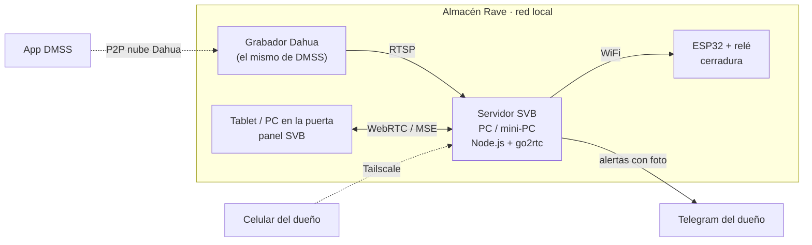

# SVB Seguridad · Almacén Rave

**Sistema Vincular Business — Soluciones de Seguridad.** Panel de seguridad táctil (web, celular y Windows) con cámaras Dahua en vivo, control de cerradura, PIN de coacción, botón SOS 911, asistente de voz, pases QR/NFC para proveedores, detección de merodeo y sabotaje con IA en el borde, y alertas con foto al celular del dueño.

  

---

## Cómo funciona



- **DMSS sigue funcionando igual.** DMSS entra por P2P (la nube de Dahua) con el número de serie. Los navegadores no pueden usar ese P2P, así que el **servidor SVB** se conecta al grabador **por la red local** (RTSP) y convierte el video a WebRTC/MSE con [go2rtc](https://github.com/AlexxIT/go2rtc).
- **No hace falta saber la IP del grabador:** con `CAM_HOST=auto`, el servidor barre la red y encuentra el equipo cuyo número de serie coincide con el de DMSS.
- **El panel funciona aunque se caiga el servidor** (modo autónomo con PINs de respaldo y cámara local).

## Instalación rápida (Windows)

1. Instalar **Node.js LTS** desde <https://nodejs.org>.
2. Descargar este repositorio (botón verde **Code → Download ZIP**) y descomprimirlo, por ejemplo en `C:\SVB`.
3. Doble clic en **`iniciar-windows.bat`**. La primera vez crea el archivo `.env` y lo abre en el Bloc de notas.
4. Completar en `.env` con los datos de DMSS (DMSS → Dispositivos → *rave* → ⓘ):
   ```ini
   CAM_SERIAL=<Número de serie que muestra DMSS>
   CAM_USER=admin
   CAM_PASS=<Contraseña del dispositivo>
   CAM_HOST=auto
   ```
   y cambiar `DOOR_PIN`, `DURESS_PIN` y `ADMIN_PIN`. Guardar.
5. Doble clic otra vez en `iniciar-windows.bat`. Descarga go2rtc, busca el grabador y abre <http://localhost:8080>.
6. En la tablet de la puerta (misma WiFi) abrir `http://IP-DE-LA-PC:8080` y en el menú del navegador elegir **Instalar app / Agregar a pantalla de inicio**.

> La PC del servidor tiene que estar en **la misma red** (WiFi o cable) que el grabador Dahua. Si Windows pregunta por el firewall, permitir **redes privadas**.

### Si no encuentra el grabador
- Ejecutar `cd server && npm run discover` para ver qué equipos hay en la red.
- O buscar la IP del grabador en el router (lista de dispositivos DHCP) o con la app *ConfigTool* de Dahua, y ponerla fija: `CAM_HOST=192.168.1.108`.
- Verificar en el grabador que **RTSP esté habilitado** (Configuración → Red → Puerto → RTSP 554) — viene activado de fábrica.

## Funciones

| Módulo | Qué hace |
|---|---|
| **Teclado + PIN** | Abre la cerradura. 5 errores → bloqueo de 60 s y aviso al dueño. Validación del lado servidor. |
| **PIN de coacción** (`9999`) | Abre normalmente, **sin ninguna diferencia visible**, pero toma 3 fotos encubiertas, registra `CRITICAL_DURESS_EVENT` y manda alerta silenciosa con foto a Telegram. |
| **SOS 911** | Cuenta regresiva de 3 s (cancelable), foto automática, alerta al dueño y llamada `tel:911`. |
| **Familiar** | Llamada al contacto de confianza + WhatsApp de auxilio con ubicación. |
| **Timbre** | 5 timbres sintetizados; manda la foto del visitante al celular del dueño. |
| **Cámaras Dahua** | Grilla 2×2 (hasta 3×3) en vivo, toque para ampliar en HD, modo IR/noche, reconexión automática. |
| **Edge AI** | Movimiento, **merodeo** (presencia > 10 s sin interactuar), **sabotaje** (lente tapado/cegado), detección de rostro (nativa si el navegador la tiene, simulada si no). Cualquier cámara Dahua puede ser la "cámara de puerta". |
| **Voz** | «abrir puerta 2 5 8 0», «emergencia», «llamar a 911», «ver cámaras», «tocar timbre», «cancelar». Sin servicios pagos. |
| **Pases QR / NFC** | Códigos de 6 dígitos con vencimiento para proveedores; QR para escanear, tag NFC (Android) o tipeados. Envío por WhatsApp. |
| **Auditoría** | Log en el servidor (`data/events.jsonl`) + en el panel; exportación JSON; bóveda de fotos de evidencia. |
| **Admin** (PIN `1234`) | Marca/logo, perfil Residencial/Corporativo, contactos, voz, pases, timbres, relé 100–10000 ms, cámaras, firmware ESP32, manual de streaming, auditoría, sistema. |

## Cerradura (ESP32)

Firmware: [`firmware/esp32_cerradura/esp32_cerradura.ino`](firmware/esp32_cerradura/esp32_cerradura.ino) (también visible en Admin → Firmware).

| ESP32 | Conexión |
|---|---|
| GPIO 26 | IN del módulo relé (5 V) |
| GPIO 27 | Sensor magnético de puerta → GND (opcional) |
| GPIO 25 | Pulsador de salida interior → GND (opcional) |
| Relé NA/COM | Cerradura eléctrica 12 V (fuente propia; diodo 1N4007 en paralelo) |

Completar `WIFI_SSID`, `WIFI_PASS` y `TOKEN` en el sketch, grabar con Arduino IDE (placa *ESP32 Dev Module*), y en `.env`: `ESP32_URL=http://IP-DEL-ESP32` y `ESP32_TOKEN=<mismo TOKEN>`. Sin ESP32, la apertura queda **simulada** (se registra pero no acciona nada).

## Alertas al celular (Telegram, gratis)

1. En Telegram, abrir **@BotFather** → `/newbot` → copiar el token a `TELEGRAM_BOT_TOKEN`.
2. Mandarle un mensaje al bot nuevo y abrir `https://api.telegram.org/bot<TOKEN>/getUpdates` → copiar el número de `"chat":{"id":…}` a `TELEGRAM_CHAT_ID`.
3. Admin → Contactos → **Probar alerta Telegram**.

## Ver desde fuera del almacén

No abrir puertos en el router. Instalar **[Tailscale](https://tailscale.com)** (gratis) en la PC servidor y en el celular, y entrar a `http://<nombre-de-la-pc>:8080`. Definir `PANEL_USER`/`PANEL_PASS` en `.env` para pedir usuario y contraseña.

## App de escritorio Windows (opcional)

```bash
cd desktop
npm install
npm start          # ventana normal
npm run kiosk      # pantalla completa tipo tótem
npm run dist       # genera el instalador .exe en desktop/dist
```

La app incluye el servidor, abre el panel y permite accionar la cerradura por **USB** (ESP32 conectado a la PC; Admin → Relé → *Puerto serie*). El `.env` va junto al `.exe` instalado.

## Linux / Raspberry Pi

```bash
./iniciar-linux.sh
# servicio permanente:
sudo cp docs/svb-seguridad.service /etc/systemd/system/ && sudo systemctl enable --now svb-seguridad
```

## Seguridad

- **Credenciales solo en `.env`**, que está en `.gitignore`. Este repositorio es público: nunca subir contraseñas, números de serie ni tokens.
- El servidor **no publica** `.env`, `data/` ni el código del servidor, y bloquea los endpoints de go2rtc que contienen contraseñas (`/api/config`, `/api/streams`).
- go2rtc escucha solo en `127.0.0.1`; todo pasa por el servidor SVB.
- Cambiar los PINs por defecto y usar una **contraseña fuerte en el grabador Dahua** (DMSS → Cambiar la contraseña del dispositivo; luego actualizar `CAM_PASS`).

## Pruebas

```bash
cd server && npm run setup && npm test     # 6 pruebas: Digest Dahua, autodescubrimiento, API, coacción, bloqueo, video real
python3 tests/qr.test.py                   # QR legible en versiones 1–10
python3 tests/e2e.py                       # 50 pruebas de punta a punta con navegador real
node tools/embed.js --check                # index.html sincronizado con firmware y QR
```

La prueba e2e levanta un **grabador Dahua simulado** (4 canales RTSP H.264), un ESP32 y Telegram simulados, el servidor real, y maneja el panel con Chromium: PIN, coacción, SOS, 4 cámaras en vivo, voz, pases, IA, auditoría, celular y modo sin servidor.

## Estructura

```
index.html                 Panel completo (un solo archivo, CSS + JS nativo)
manifest.webmanifest, sw.js  PWA instalable y funcionamiento offline
assets/                    Logo Rave e íconos
server/                    Servidor puente (Node.js sin dependencias)
  server.js                API, proxy de video, PINs, relé, alertas, auditoría
  lib/dahua.js             Digest auth, número de serie, URLs RTSP Dahua
  lib/discover.js          Búsqueda del grabador por número de serie
  scripts/                 Descarga de go2rtc, búsqueda por consola
firmware/esp32_cerradura/  Firmware de la cerradura
desktop/                   App Windows (Electron) + instalador
tests/                     Pruebas e2e, QR
tools/embed.js             Inserta firmware y QR en index.html
```

## Para escalar comercialmente

Cada cliente nuevo es: una PC/mini‑PC o Raspberry Pi con el servidor, su `.env` (marca, cámaras, PINs, Telegram), y una tablet en la puerta. El logo y el nombre se cambian desde Admin → Marca sin tocar código. Plantillas RTSP para Hikvision y ONVIF en Admin → Manual.
